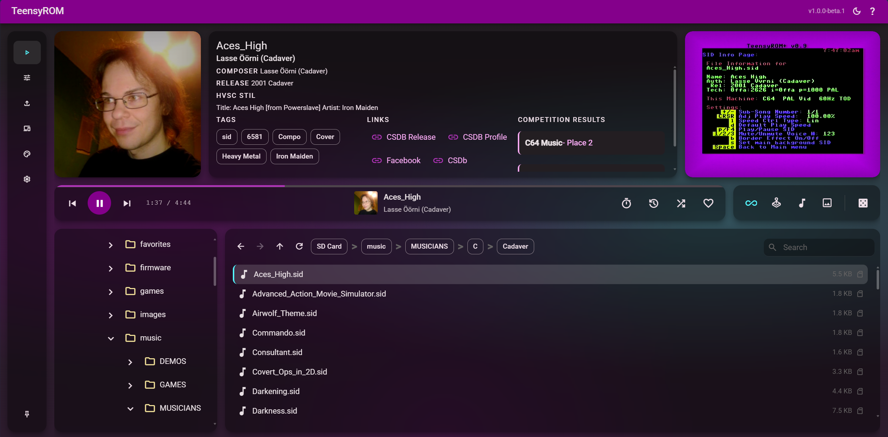
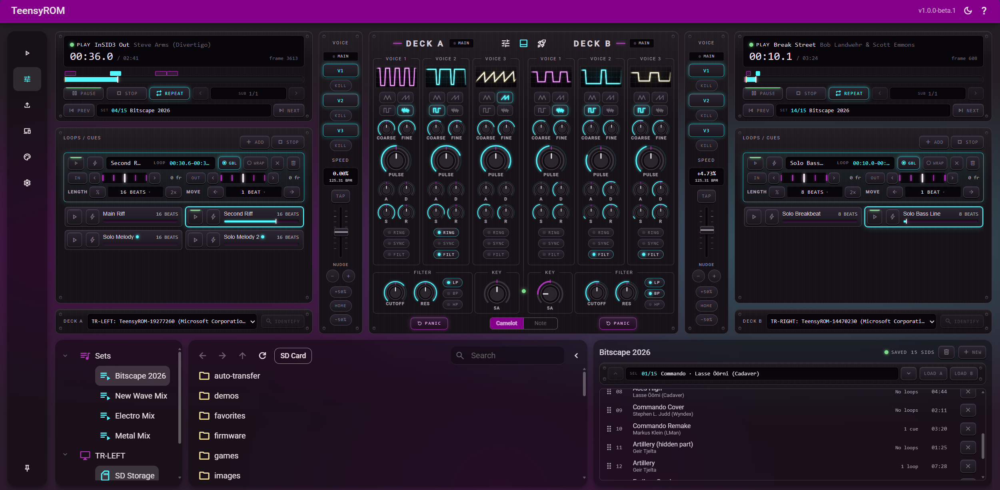
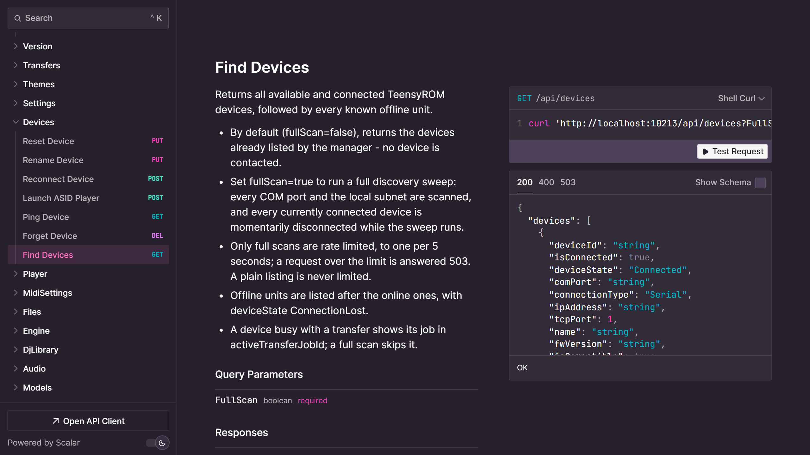
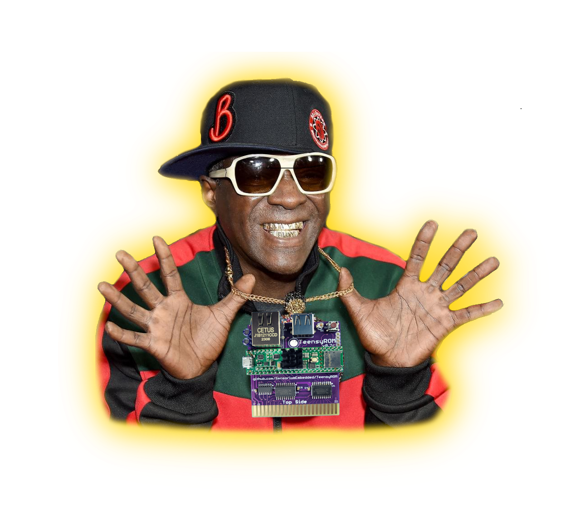

<h1 align="center">TeensyROM Suite</h1>

  <b>Turn your Commodore 64 into a jukebox, an arcade or a DJ booth.</b>

  <a href="#get-started">Get started</a> · <a href="docs/README.md">Docs</a> · <a href="https://discord.com/invite/ubSAb74S5U">Discord</a>

TeensyROM Suite is a set of apps for the [TeensyROM](https://github.com/SensoriumEmbedded/TeensyROM) cartridge. They put everything on your cart, every game, demo, SID tune and image, a click, a command or a sentence away, and it all plays on your real C64.

Browse your library from the couch, stream it like a music service, script it, ask an AI for a set, or take the stage with two C64s as your decks. Pick the app that suits the moment. They all run on Trom API, so they work with the same carts at the same time, on Windows, macOS and Linux.

## Trom UI

**Browse, search and launch your whole library from your desktop, phone or tablet.**

  
  

- **Stream it:** shuffle and auto-play games, demos, SIDs and images, hands-free.
- **Watch it:** see your C64's picture in the browser, with CRT effects.
- **Mix it:** the [DJ Mixer](docs/dj-mixer.md) turns two C64s into decks you play live, with every note from a real SID chip.
- **Make it yours:** copy files to your cart with drag and drop or watch folders, and set your C64's menu colors.

[Explore Trom UI →](docs/trom-ui.md)

## Trom Terminal

**Your library from the command line, BBS-style.**

> 🖼️ **Image placeholder:** Trom Terminal main menu

- **Guided menu:** explore and launch without learning a single command.
- **Stream Player:** plays through your library like a streaming service.
- **One-line commands:** every action as a command, with `--json` output that pipes into your scripts.

[Explore Trom Terminal →](docs/trom-terminal.md)

## Trom Agent

**Just ask.** Type `/trom` in [Claude Code](https://claude.com/claude-code) and say what you want.

> 🖼️ **Image placeholder:** Trom Agent in Claude Code

- **Play by request:** "play me some Rob Hubbard", "give me a 30-minute set", "show me demos from 1989".
- **Tours and curation:** explores your library with you, and tells you about what is playing.
- **Setup:** installs the suite, keeps it up to date, and checks your setup with Virtual Travis.

[Explore Trom Agent →](docs/trom-agent.md)

## Trom API

**Drive your cart from your own code:** launch files, search your library, copy files and set themes. It's the same API Trom UI and Trom Terminal use.

  

[Explore Trom API →](docs/trom-api.md)

## Get started

1. **Download** the suite for Windows, macOS or Linux from the [releases page](https://github.com/MetalHexx/TeensyROM-Suite/releases), or install it with Homebrew on a Mac. Trom Agent can also install it for you.
2. **Connect** your TeensyROM over USB or your network.
3. **Play.** Open Trom UI at `http://localhost:10213`, run `trom`, or type `/trom` in Claude Code.

[Getting started](docs/getting-started.md) has the details, from your first download to a fully indexed library.

## Discord

Join the TeensyROM community on Discord for support, discussions, and updates:

  

## Contributing

This project is mostly a one-person effort, and ideas and testing help are welcome. Come talk to me on Discord, or tag @hExx. To build from source, see [contributing](docs/contributing.md).

## Acknowledgments

- **Travis Smith / Sensorium** - Creator of the [TeensyROM Hardware](https://github.com/SensoriumEmbedded/TeensyROM)
- **Jens-Christian Huus / DeepSID** - [DeepSID Repo](https://github.com/Chordian/deepsid) SID metadata sourced from this projects database.
- **StatMat / Oneload64** - [Oneload64](https://oneload64.github.io/) game image metadata sourced from this project.
- **HVSC Community** - For the amazing SID music collection and SID metadata (STIL) resources.
- **LaLa's SIDList** - [SIDList](https://www.transbyte.org/SID/SIDlist.html) For the handy CSV format HVSC STIL file metadata.
- **Jamie Honn (JTHonn)** - Extensive early Windows and Mac testing.

## Legacy projects

- [TeensyROM-UI](https://github.com/MetalHexx/TeensyROM-UI): the original Windows desktop app.
- [TeensyROM-CLI](https://github.com/MetalHexx/TeensyROM-CLI): the original command-line tool.

## License

See [LICENSE.md](LICENSE.md) for details.

  

