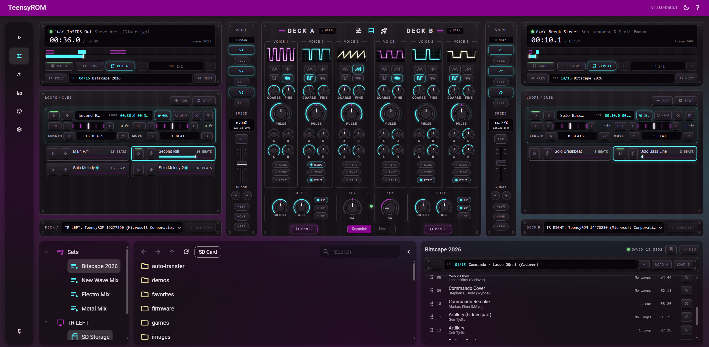

# DJ Mixer

## What it is

Two decks of SID music, played live through real C64s. Every note is made by the SID chip itself, and none by an emulator. Load a tune on each deck, match their tempos by BPM, shape the sound, loop and cue on the beat, scratch, and mix between them.

The DJ Mixer is part of Trom UI.

## What you need

- A browser with MIDI support, such as Chrome or Edge, on the computer that runs the suite.
- The TeensyROM each deck plays through, connected by USB.
- Optionally, a MIDI controller.

Allow MIDI access when the browser asks, then pick the TeensyROM each deck plays through.

## Load tunes

Browse the SD and USB storage of every connected cart, along with your saved sets, or search the storage you have open. Load a tune onto either deck, or load a whole set onto a deck.

## Play a deck

- **Transport:** play, pause, stop and repeat the tune.
- **Position:** see how far in you are, and jump to any point.
- **Tunes:** step to the previous or next tune in the loaded set, and to the previous or next sub-tune of the tune that is loaded.
- **Speed:** change the playback speed in steps as fine as 0.01%, nudge it up or down for a moment, or return to normal.
- **Voices:** mute any of a tune's three voices, or hold one.

## Beat grid and BPM

Each deck shows the BPM of its tune. Match two tunes by setting their speeds until the BPMs agree. Tap along with a tune to set its beat grid yourself.

## Shape the sound

Each deck gives you the SID chip's controls for each of its three voices:

- Waveform, coarse and fine pitch, and pulse width.
- Attack, decay, sustain and release.
- Ring modulation, sync, and whether the voice runs through the filter.

The filter has a cutoff, a resonance and its modes. You can also move the whole tune up or down in semitones, and silence the deck at once if something hangs.

The settings show the chip's live values as the tune plays, and every voice has an oscilloscope-style wave of what it is playing.

## Loops and cues

Each deck keeps a list of loops and cues for the tune it holds. When the tune has a beat grid, they land on beats.

- **Set:** add a marker at the current position. Give it an end to make it a loop, or leave it as a cue. Stop a running loop at any time.
- **Start and end:** set a marker's start or end at the current position.
- **Length:** halve or double a loop, or set its length in beats, up to 128.
- **Move:** move a loop, or just its start or end, by 1, 2, 4, 8 or 16 beats.
- **Fine tune:** nudge a marker's start or end by up to a second.
- **Name:** rename any marker.
- **Jump:** jump to a marker, or start it right away.
- **Own mixer settings:** a marker follows the deck's settings by default. Give it voice, filter and key settings of its own, and the list shows which markers have them.

## Sets

A set is an ordered list of tunes for a performance.

- **Build:** add tunes to a set from the storage you are browsing.
- **Arrange:** put the tunes in the order you want and remove the ones you don't.
- **Name:** rename a set, create a new one, or delete one.
- **Play:** load the set onto either deck, then step through it tune by tune.

## Key match

You can adjust the key for playing track on either deck to help make tunes harmonically compatible for mixing. A light between the decks shows how well the keys of the two loaded tunes fit, from a full match through close and possible to a clash. It is unlit when a deck's tune has no key. Use it to judge a mix before you bring a tune in. Show keys as Camelot codes or as note names.

## Cue by Hand or Scratch

If you have a pitch bend touch trip like on the [Arturia Minilab 3](https://www.arturia.com/store/midi-controllers-sequencers/minilab-3), cueing up a new track by hand is as easy as it is on vinyl or CDJ hardware.  Hold, back cue, forward cue or even "throw" the tune and it will settle back to the deck's speed just like vinyl would on a real turntable. Yeah, you can even scratch with it!

## MIDI Controllers

Just about every control on the UI surface is mappable to any number of MIDI Controllers with an intuitive visual interface and many tuning options.

## Start the ASID player

The decks play through the ASID player on each cart with a click of a button.

## What's remembered

The mixer remembers your work across a refresh of the page:

- A tune's loops, cues, beat grid, SID register settings are kept per tune and per loop/cue.
- Your sets, and the settings and markers of each tune in them, are kept per set.
- Your controller mappings and their settings are stored and kept safe on your disk.
