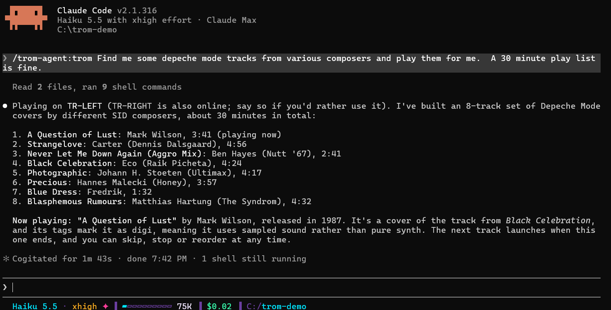

# Trom Agent

Trom Agent is your TeensyROM companion inside [Claude Code](https://claude.com/claude-code). Type `/trom` and ask for what you want in plain words: play something, build a set, tour your library, or sort out your setup. It does the work for you through [Trom Terminal](trom-terminal.md).

It also installs TeensyROM Suite for you if you don't have it yet, and keeps it up to date.

Plugins for other AI coding agents are coming soon.



## Install

In Claude Code, add the marketplace and install the plugin:

```
/plugin marketplace add MetalHexx/tr-plugin-marketplace
/plugin install trom-agent@tr-plugin-marketplace
```

Then start a session by typing `/trom`. Trom Agent greets you, picks your cart and offers a quick tour. If the suite isn't installed, it offers to install it first, and asks before it runs anything.

## What you can ask

Each section links to the Trom Terminal page for the commands behind it.

### Play and shuffle

Launch games, SID tunes, demos and images on your real C64, by name, artist or theme. Trom Agent tells you a little about what is playing.

- "play me some Rob Hubbard"
- "shuffle some games"
- "show me demos from 1989"

See [one-line commands](trom-terminal.md#one-line-commands).

### DJ-style timed sets

Build a set that runs for the time you choose and moves on by itself. The tunes play one after another, whole, on your cart. For two decks mixed live, use the [DJ Mixer](dj-mixer.md) in Trom UI.

- "give me a 30-minute set"
- "an hour of SID music, nothing slow"
- "keep it going until I say stop"

See the [Stream Player](trom-terminal.md#stream-player).

### Library tours and curation

Browse your library folder by folder, search it, favorite what you love and ban the stinkers.

- "walk me through my music folder"
- "find everything by Martin Galway"
- "ban that one"

See [searching, favorites and bans](trom-terminal.md#one-line-commands).

### Copy files and watch folders

Send files to your cart or bring them back, and set up a folder on your computer that sends whatever lands in it to your cart. Trom Agent asks before it changes anything.

- "copy this folder to my games folder"
- "download my favorites folder"
- "watch my Downloads folder and send new files to the cart"

See [copy files](trom-terminal.md#copy-files) and [watch folders](trom-terminal.md#watch-folders).

### Themes

Set the colors of your C64's menu, from a shipped theme or one of your own. Applying a theme resets the C64.

- "make my C64 look like CGA"
- "save these colors as Night"
- "what theme am I on?"

See [themes](trom-terminal.md#themes).

### Install and update the suite

Trom Agent installs TeensyROM Suite from its newest release: with Homebrew on a Mac, and from a checked download on Windows and Linux, with `trom` put on your PATH. When a newer release is out, it tells you as a session starts and updates once you agree.

- "install TeensyROM Suite"
- "is there a newer release?"
- "update the suite"

See [getting started](getting-started.md#with-trom-agent).

### The setup doctor

When something is off, Trom Agent calls over Virtual Travis. He checks Trom Terminal, Trom API, Trom UI, your cart and your index, explains what he finds, and walks you through the fixes.

- "check my setup"
- "my cart won't show up"
- "why is search finding so little?"

Virtual Travis is an AI stand-in, modeled on the warm, patient support Travis Smith gives TeensyROM users. He is not Travis.

## Keep it up to date

When a new release of the suite is out, Trom Agent tells you as the session starts and updates it with `trom update` once you agree. You can also ask it to update. To update the plugin itself, run these in Claude Code:

1. `/plugin marketplace update tr-plugin-marketplace`
2. Update or reinstall `trom-agent@tr-plugin-marketplace` from `/plugin`.
3. Restart your Claude Code session, so the new version loads.

## Next

- [Getting started](getting-started.md): install the suite and connect your cart.
- [Trom Terminal](trom-terminal.md): the commands Trom Agent runs for you.
