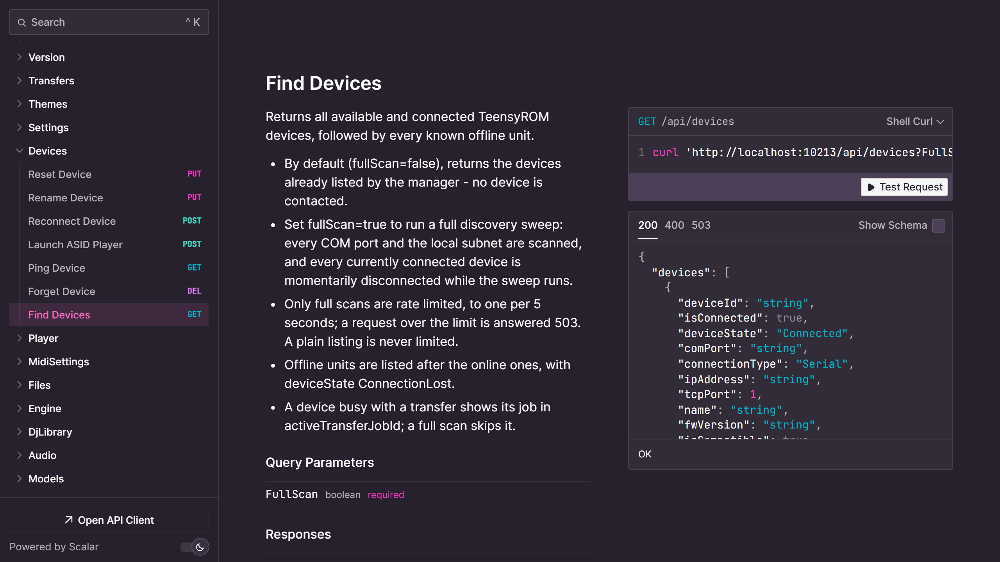
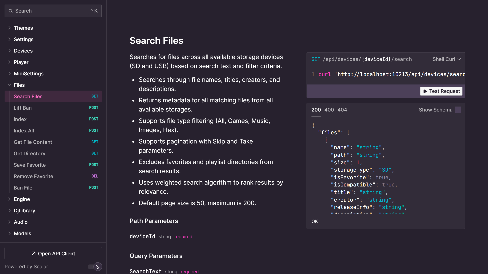

# Trom API

Trom API is the server at the heart of TeensyROM Suite. It talks to your carts, and [Trom UI](trom-ui.md) and [Trom Terminal](trom-terminal.md) both work through it. You can also run it on its own, without the UI, to build your own client or automation.

## Run it

- **Homebrew:** run `trom-suite`.
- **A download:** run `TeensyRom.Api` (`TeensyRom.Api.exe` on Windows) from the folder you unpacked. [Getting started](getting-started.md) covers the download.

It listens on port `10213`.

## Build your own tools

Your tools can do what Trom UI and Trom Terminal do: launch files, browse and search your library, copy files, manage favorites and bans, and set themes. Call it over HTTP from any language, or generate a client from its OpenAPI spec at [http://localhost:10213/openapi/v1.json](http://localhost:10213/openapi/v1.json).

## API docs

With Trom API running, its API documentation is at [http://localhost:10213/scalar/v1](http://localhost:10213/scalar/v1).

