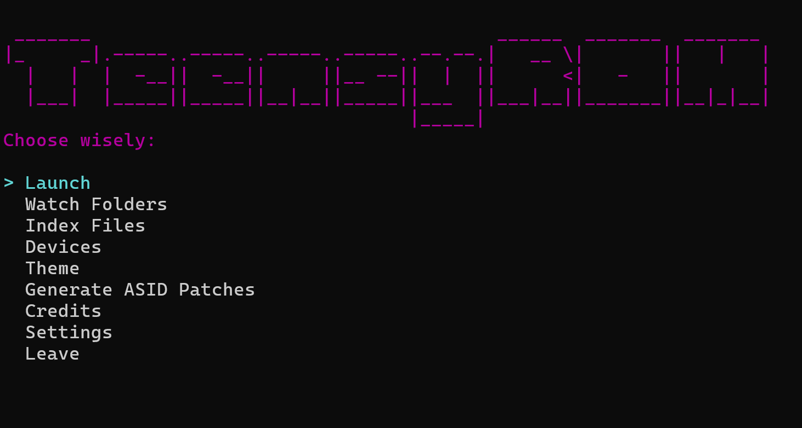
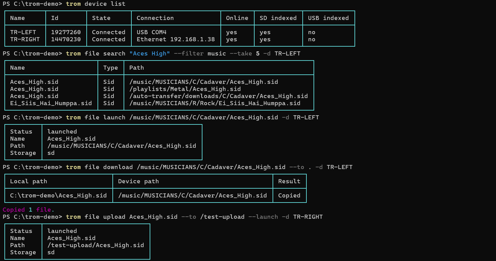

# Trom Terminal

Trom Terminal is the command line of TeensyROM Suite. Use `trom` as a guided, BBS-style menu, or run one-line commands for scripts and automation. It works on Windows, macOS and Linux, and it controls the same carts as [Trom UI](trom-ui.md).

`trom` starts Trom API for you when it needs it, and shares it with Trom UI. Whatever you do in one, the other sees.

New here? [Getting started](getting-started.md) covers installing the suite and putting `trom` on your PATH.



## What you can do

- **Launch remotely:** start games, SID music, demos and images on your C64 from the terminal.
- **Stream like a service:** auto-play SIDs, games and images, one after another.
- **Favorites and bans:** tag the files you love and ban the stinkers.
- **Search:** find files by name, artist, STIL description and more.
- **Browse:** walk through your SD and USB storage folder by folder.
- **Copy files:** send files and folders to your cart, or bring them back.
- **Watch folders:** send whatever lands in a folder on your computer to your cart.
- **Themes:** set the colors of your C64's menu.
- **Scripts and automation:** every command takes `--json`, and commands pipe into each other.

## The guided menu

Run `trom` on its own and follow the prompts. The menu reaches everything above, and it prints a line whenever a transfer starts or ends, whether a watch folder or another app started it.

## Stream Player

The Stream Player plays through your library like a streaming service. Open it from Launch in the guided menu, or start it on a file with `--player`:

```bash
trom file launch /music/MUSICIANS/T/Tjelta_Geir/Artillery.sid --player
trom file random --filter music --player
```

Skip to the next or previous file, pause and resume, favorite or ban what is playing, and share it. Shape the stream with a mode, a filter, a play timer or a pinned folder. A timer moves games, demos and images along by themselves.

> 🖼️ **Image placeholder:** Stream Player

## One-line commands

Everything the menu does has a one-line command. `trom --help` lists the groups, and `trom <group> --help` goes deeper. Every command takes `--json`.

With one cart online, `trom` picks it. With several, name one with `--device`.

```bash
trom file launch /music/MUSICIANS/T/Tjelta_Geir/Artillery.sid
trom file random --filter music --directory /music
trom file next
trom file pause
trom file search commando --filter music --take 10
trom file favorite /music/Commando.sid /music/Delta.sid
trom file ban /music/Delta.sid
```



- **Launch:** `file launch` starts one file. `file random` launches a random one, and is how you shuffle: narrow it with `--filter` and `--directory`.
- **Move along:** `file next` and `file previous` step through what you were playing. `file pause` pauses or resumes a song, and `file stop` stops whatever is running.
- **Find:** `file ls` lists a folder, and `file search` searches the files you have indexed. Run `trom index build` first so search covers everything; [getting started](getting-started.md#index-your-storage) explains why.
- **Curate:** `file favorite` and `file unfavorite` tag files. `file ban`, `file banned` and `file unban` hide files and folders from browsing, search and shuffle. See [bans](getting-started.md#bans).

## Copy files

Copy files and folders to your cart, or back to your computer. Folders keep their layout, and `.zip`, `.7z` and `.rar` files are unpacked on the cart.

```bash
trom file upload ./roms --to /games
trom file upload ./Artillery.sid --to /music --launch
trom file download /music/Artillery.sid --to ./backup
```

Only the file types a TeensyROM takes are sent. A copy can reset the cart, which stops what is running.

## Watch folders

A watch folder sends whatever lands in a folder on your computer to your cart, and launches it if you ask.

```bash
trom watch-folder add ./roms --path /games
trom watch-folder list
trom watch-folder pause ./roms
trom watch-folder resume ./roms
trom watch-folder remove ./roms
```

Add `--launch` to start each file as it lands, and use `trom watch-folder set` to change a destination. The rules are the same as in [Trom UI](trom-ui.md#watch-folders). You can also manage watch folders from the guided menu.

## Themes

Set the colors of your C64's menu from the guided menu, or with `trom theme`.

```bash
trom theme list
trom theme apply the-blues
trom theme save Night c64-mono --border blue
```

Applying a theme resets the C64. A theme you save here shows up in Trom UI, and the other way round.

## Pipe commands together

Commands pass files to each other, so scripts stay short. A `-` makes a command read its input from the one before it. This one searches, takes the first result and launches it:

```bash
trom file search commando --json | jq -r '.[0].path' | trom file launch -
```

## Generate ASID presets for Chipsynth

Chipsynth C64 can stream ASID MIDI to external hardware such as your TeensyROM. This command makes copies of your Chipsynth presets with ASID-friendly settings: volume at 0 to silence the emulated SID, mono polyphony, and the SID clock you choose.

```bash
trom chipsynth generate --source "c:\your\preset\directory" --target ASID --clock ntsc
```

It scans the preset folder and its subfolders for `.fermatax` files and writes the copies into a new folder named by `--target`. Your originals are never overwritten, and the new presets show up in Chipsynth's preset browser the next time you start it.
Read more in the [TeensyROM ASID player documentation](https://github.com/SensoriumEmbedded/TeensyROM/blob/main/docs/ASID_Player.md).

## Next

- [Trom UI](trom-ui.md): the same library in your browser.
- [Trom Agent](trom-agent.md): ask for all of this in plain words from Claude Code.
- [Trom API](trom-api.md): run the API without the UI.
