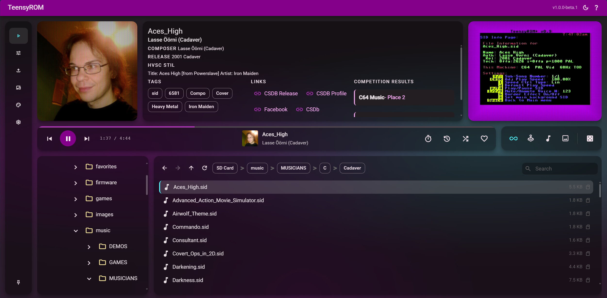
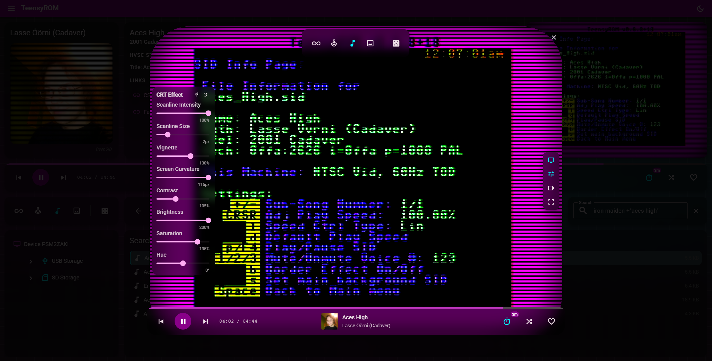
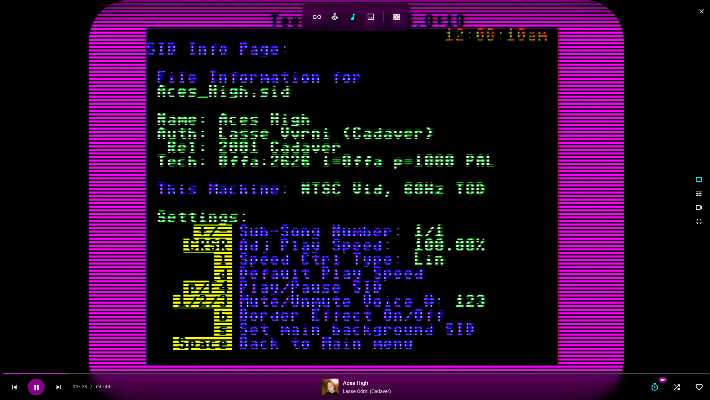

# Trom UI

Trom UI is the web app of TeensyROM Suite. Browse your TeensyROM's SD and USB storage, launch games, demos, SID music and images on your C64 from any browser, and stream it all like a retro media service. It also copies files to your cart, watches folders on your computer, sets your C64's menu colors, and hosts the [DJ Mixer](dj-mixer.md).

<table>
  <tr>
    <td align="center">
      <b>Launch games and SIDs</b> 
      
    </td>
    <td align="center">
      <b>With CRT emulation</b> 
      
    </td>
    <td align="center">
      <b>And full screen immersion</b> 
      
    </td>
  </tr>
</table>

New here? [Getting started](getting-started.md) covers installing the suite and connecting your cart.

## Media player and playback

- **File launch:** launch games, demos, SID music and images on your C64 remotely.
- **Random launch:** launch a random file of any type from your storage.
- **Playback controls:** play, pause, stop, next and previous.
- **Launch modes:**
  - **Sequential:** step through files in directory order.
  - **Shuffle:** play random files, with a scope and filters you choose.
- **Progress:** see the elapsed and total time of what is playing.
- **Auto-play:** keeps playing through a directory or a shuffle queue.
- **File compatibility:** files that can't run are flagged right away and skipped automatically.
- **Custom play timer:** moves on by itself after a time you set, for a continuous stream of games, demos and images.
- **Current file info:** metadata, creator, release info and status for what is playing.

## Video and CRT emulation

Video is optional but recommended.

- **Modern meets retro:** streaming-style controls laid over an authentic CRT picture.
- **Live video:** shows the picture from a connected video capture device.
- **CRT effects:**
  - **Scanlines:** with size and intensity controls.
  - **Vignette:** darkened edges that follow the screen's curve.
  - **Barrel distortion:** curved glass, like a CRT tube.
  - **Bloom:** a phosphor glow on bright areas.
  - **Chromatic aberration:** RGB color separation, like a lens.
  - **Screen curvature:** rounded edges, like convex glass.
- **Phosphor looks:**
  - **RGB patterns:** Aperture Grille (Trinitron), Shadow Mask (traditional) and Dot Triad (arcade).
  - **Monochrome:** white, amber or green terminal phosphor.
- **Color adjustments:** contrast, brightness, saturation and hue.
- **Display modes:** compact inside the player, expanded, or fullscreen.
- **CRT presets:** save and load your own effect settings.
- **Auto cropping:** removes black bars and borders with smooth transitions, aware of PAL and NTSC.

## Search and filter

- **Search everything at once:** one search across the indexed SD and USB storage of every connected cart. Index your storage first; [getting started](getting-started.md#index-your-storage) shows how.
- **Phrases and required words:** the [search syntax](getting-started.md#search-syntax) supports quoted phrases and required words.
- **Results:** browse and launch search results.
- **File type filters:** All, Games, Music, Images or Demos.
- **Banned files and folders:** hide files and folders from browsing, search and shuffle. See [bans](getting-started.md#bans).

## Play history and favorites

- **History:** every launched file is recorded with a timestamp.
- **History navigation:** step backwards and forwards through what you played.
- **Relaunch:** browse the history and launch from it.
- **Favorites:** mark files as favorites and toggle them at any time.

## File browser and navigation

- **Dual storage:** browse SD and USB side by side, each with its own directory tree.
- **Folder navigation:** pick folders from a tree, or jump back to a parent folder.
- **Large folders:** browsing stays smooth in folders with thousands of files.
- **Back and forward:** retrace your steps through folders, like a browser.
- **Several carts:** browse multiple connected carts at the same time.

## Mobile and responsive

- **Any screen:** works on everything from small phones to large desktop monitors.
- **Touch friendly:** designed for touch screens as well as a mouse.
- **Adaptive layouts:** the layout reorganizes itself for phone, tablet and desktop.
- **No app install:** open Trom UI from any browser on your local network.

  
   
  <em>Watch the phone demo</em>

## Mobile audio streaming

- **Wireless C64 audio:** stream your C64's audio to your phone or tablet, no cables needed.
- **Audio source:** pick which audio input of the computer to stream.
- **Low latency:** compressed streaming keeps the sound in sync with what your C64 is doing.

## Copy files to your cart

Send files from your computer to your cart's storage.

- **Pick where they go:** choose a cart and a folder on it.
- **Drag, or choose:** drop files or whole folders in, or pick them.
- **Live progress:** each transfer shows how far it has come, the speed, how long it has taken and which files failed. You can cancel a transfer while it runs.
- **Archives:** `.zip`, `.7z` and `.rar` files are unpacked on the way in.
- **File types:** only the types a TeensyROM takes are sent, and the rest are left out.
- **Auto launch:** a transferred file can start on the cart as soon as its transfer finishes.
- **One at a time:** a cart takes one transfer at a time. If it is busy, you can retry once it is free.

A transfer resets the cart, unless it is idle with nothing launched, and a reset stops whatever is running.

## Watch folders

A watch folder sends whatever lands in a folder on your computer to your cart, and launches it if you ask. It suits things like a browser downloads folder for firmware, or the output folder of a build or a music tool.

For each watch folder you choose:

- **Folder to watch:** a folder on the computer that runs the suite. Files that land in it or its subfolders are sent.
- **Cart and storage:** which cart gets the files, on SD or USB.
- **Cart folder:** where on the cart the files go.
- **Auto launch:** start a file on the cart as soon as it lands.
- **More carts:** send the same folder to several carts.

You can edit a destination, turn a folder off and on, and remove it.

Only files that arrive after you add the folder are sent, and only of types the TeensyROM takes. Archives are unpacked on the cart. Your files stay in the folder: they are copied, never moved or deleted. Files that land close together go as one transfer. A file that lands while its cart is busy with another transfer is skipped, and a file that lands while its folder is turned off is not sent later. A transfer from a watch folder resets the cart like any other, which stops what is running.

You can also manage watch folders from [Trom Terminal](trom-terminal.md) with `trom watch-folder`.

## Themes

Change the colors of your C64's menu.

- **Pick a theme:** choose from the shipped themes, or from your own saved ones.
- **Tune your own:** change any of the menu's seven colors using the C64's 16 colors.
- **Save it:** shipped themes are read-only, so save an edited copy with a name of your own.
- **Apply to your carts:** apply to one cart or to all of them.

Applying a theme resets the C64. A theme you save here also shows up in [Trom Terminal](trom-terminal.md).

## DJ Mixer

The DJ Mixer plays two SID tunes live on two decks, through real C64s, with a deck for each cart. See [DJ Mixer](dj-mixer.md) for what it needs and how to use it.
